# How the RNGD AI Studio works

**Agents, knowledge base, physics engine, hotel design generation, and whether it hallucinates**

*RNGD concept-to-schematic semester proof of concept. Written 2026-10-06 from the code in `src/rngd/`, from experiments in
`src/how_it_works_experiments.py` (results in `experiments.json`) and from three real pipeline runs made on 2026-10-05.
Diagrams are Mermaid and maths is LaTeX; both render on GitHub and in VS Code's Markdown preview.*

---

## Contents

1. [The short answer](#1-the-short-answer)
2. [System overview](#2-system-overview)
3. [The multi-agent pipeline: inputs, outputs, decisions](#3-the-multi-agent-pipeline-inputs-outputs-decisions)
4. [Knowledge base and retrieval (RAG)](#4-knowledge-base-and-retrieval-rag)
5. [The physics engine](#5-the-physics-engine)
6. [Computer-vision QA and the critic loop](#6-computer-vision-qa-and-the-critic-loop)
7. [How the hotel design is created](#7-how-the-hotel-design-is-created)
8. [Is it hallucinating, or is it dynamic? The evidence](#8-is-it-hallucinating-or-is-it-dynamic-the-evidence)
9. [Limitations and what to improve](#9-limitations-and-what-to-improve)
10. [How to reproduce everything here](#10-how-to-reproduce-everything-here)

---

## 1. The short answer

| Question | Answer |
|---|---|
| **Which parts use AI (LLMs)?** | Five pipeline agents (intake, zoning, BaaP matching, conflict, design critic), one arbiter call, and the chat assistant. They **read text and make judgments**. |
| **Which parts are deterministic code?** | All geometry and all arithmetic: buildable envelope, module counts, areas, feasibility numbers, the physics simulation, computer-vision measurements, floor plates, the IFC models, the **entire hotel design**, code checks and drawings. |
| **Does the design change with the inputs?** | Yes. The hotel engine produced four different, correct layouts for four different inputs (Section 8.1), and each layout was **bit-for-bit identical** when rebuilt. |
| **Do the LLM agents make up facts?** | In the tests run: **no invented numbers**. Intake extracted exactly what each request said (3/3 runs). Zoning extracted all 9 limits correctly against the knowledge base (2/2 runs). Every number in the arbiter's narrative traces back to computed data (5/5). |
| **Where can it still go wrong?** | Free-text judgments vary between runs: conflict count and severity, and whether the critic tries another iteration. The chat assistant can state code facts that are not in RNGD's documents. That is why the code screens, not the chat, are authoritative. |

---

## 2. System overview

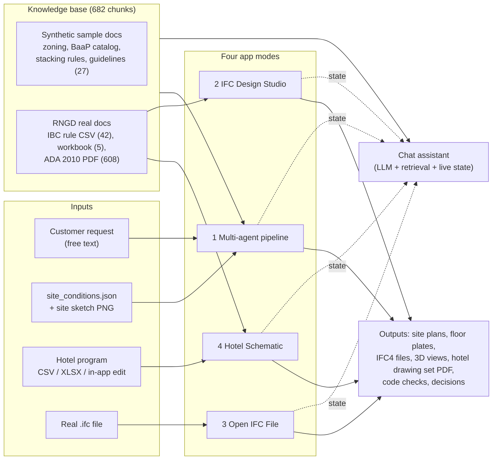

**Technology:**
- **Language and app:** Python 3.11, with a Streamlit web app.
- **Language models:** OpenRouter. A light model (`openai/gpt-oss-20b`) handles parsing, a reasoning model (`openai/gpt-oss-120b`) handles analysis, and one Claude model (`anthropic/claude-sonnet-5`) is the arbiter. Chinese-developed models are blocked in code.
- **Retrieval:** sentence-transformers `all-MiniLM-L6-v2` embeddings.
- **Simulation and vision:** NumPy and SciPy for the physics; SciPy and scikit-image for computer vision.
- **BIM:** IfcOpenShell.
- **Graphics:** Plotly (interactive 3D) and Matplotlib (drawings).
- **Reports:** LaTeX/Tectonic for the PDFs.

---

## 3. The multi-agent pipeline: inputs, outputs, decisions

### 3.1 The blackboard

All agents share one typed state object, `ProjectState` (pydantic). Each step reads what earlier steps wrote and adds its
own section. Every step is wrapped in `traced_call`, which records agent, action, model, status, latency and a summary.
This makes every run auditable.

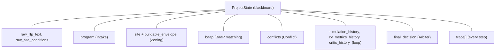

### 3.2 The run, step by step

```mermaid
sequenceDiagram
    autonumber
    participant V as Vision input (CV)
    participant I as Intake (LLM light)
    participant Z as Zoning (LLM + RAG)
    participant B as BaaP matching (LLM + RAG)
    participant C as Conflict (LLM)
    participant P as Physics simulation
    participant Q as Vision QA (CV)
    participant K as Design critic (LLM)
    participant F as Floor-plate packer
    participant A as Arbiter (Claude)
    V->>V: measure sketch, cross-check site_conditions
    I->>I: request text -> CustomerProgram (JSON)
    Z->>Z: retrieve code passages, extract limits; Python computes envelope
    B->>B: Python computes module counts & GSF; LLM writes adjacency plan
    C->>C: Python computes FAR / coverage / parking numbers; LLM judges conflicts
    loop up to 3 iterations
        P->>Q: relax building/driveway/stalls, render site plan PNG
        Q->>K: re-measure PNG: footprint, coverage, violations, stalls
        alt geometry ok and no parking shortfall
            Q-->>F: done
        else
            K->>P: param deltas (width/depth/driveway) or stop
        end
    end
    F->>F: pack unit modules on double-loaded corridor (ground + typical)
    A->>A: read the whole blackboard -> decision, confidence, narrative
```

### 3.3 Each agent: input, what the LLM does, what Python does, output

The key design rule: **the model never does the arithmetic.** It reads and judges; Python computes.

| # | Agent (model) | Input | LLM does | Python does | Output |
|---|---|---|---|---|---|
| 1 | Vision input (no LLM) | site sketch PNG + georeference | — | colour masks, connected components, pixel→feet, compare with stated lot | `cv_cross_check` (consistent / discrepancies) |
| 2 | Intake (`gpt-oss-20b`) | request text | extract units, mix, floors, amenities, parking, budget, hard vs soft requirements | validate against `CustomerProgram` schema | `program` |
| 3 | Zoning (`gpt-oss-20b` + RAG) | district + 6 targeted retrieval queries | read code excerpts, return limits, **`null` if not found**, with citations | **buildable envelope** from lot, setbacks, easements | `site` (limits, envelope, citations) |
| 4 | BaaP matching (`gpt-oss-120b` + RAG) | program + stacking rules | adjacency plan, utilisation notes | **module counts, unit GSF, building GSF, footprint, core count, accessible units** | `baap` |
| 5 | Conflict (`gpt-oss-120b` + RAG) | program, site, BaaP + precomputed numbers | name conflicts, severity, recommendations | **FAR capacity, coverage capacity, required stalls, parking area, land left** | `conflicts` + numbers |
| 6 | Physics (no LLM) | envelope, footprint, stalls, driveway | — | rigid-body relaxation (Section 5) | body positions, convergence stats |
| 7 | Vision QA (no LLM) | rendered site-plan PNG | — | re-measure footprint, coverage, setback/easement/overlap violations, **stall count** | `cv_metrics` |
| 8 | Design critic (`gpt-oss-120b`) | CV metrics + convergence stats | decide: adjust geometry or stop; reason | clamps deltas to 3 allowed keys; forces stop at max iterations | `critic` (deltas, continue?) |
| 9 | Floor-plate packer (no LLM) | module counts, BaaP catalog | — | bay-packing along a double-loaded corridor | ground + typical floor plates |
| 10 | Arbiter (`claude-sonnet-5`) | the whole blackboard (JSON) | final decision, confidence, narrative, unresolved issues, next steps | schema validation | `final_decision` |

### 3.4 The maths the Python side computes

**Buildable envelope** (zoning agent). With frontage $W_{lot}$, depth $D_{lot}$, side setbacks $s_w, s_e$, front $s_f$,
rear $s_r$, and non-buildable easements of width $e$ on a side:

$$
x_{min} = s_w,\quad x_{max} = \min(W_{lot} - s_e,\; W_{lot} - e_{east}),\quad
y_{min} = s_f,\quad y_{max} = D_{lot} - s_r
$$

$$
W_{env} = x_{max} - x_{min},\qquad D_{env} = y_{max} - y_{min},\qquad A_{env} = W_{env}\,D_{env}
$$

Elm Street: $200 \times 300$ ft lot, setbacks 10/10/15/20 ft and a 20 ft east easement, so
$W_{env} = 180 - 10 = 170$ ft, $D_{env} = 280 - 15 = 265$ ft and $A_{env} = 45{,}050$ SF.

**Module counts and areas** (BaaP agent). For mix fractions $p_t$ and total units $N$, the last type absorbs rounding:

$$
n_t = \operatorname{round}(N\,p_t)\ \ (t < T),\qquad n_T = N - \sum_{t<T} n_t
$$

$$
GSF_{units} = \sum_t n_t\, a_t,\qquad GSF_{bldg} = \frac{GSF_{units}}{\phi},\qquad
A_{fp} = \frac{GSF_{bldg}}{F},\qquad \text{cores} = \left\lceil \frac{N/F}{45} \right\rceil
$$

with $a_t$ the module area from `data/baap_catalog.json`, grossing factor $\phi = 0.85$ and $F$ floors. Elm Street:
$24/54/42$ modules give $GSF_{bldg} = 111{,}988$ SF and $A_{fp} = 27{,}997$ SF per floor.

**Feasibility numbers** (conflict agent). These are given to the LLM, which is told not to recompute them:

$$
GSF_{max} = A_{lot}\cdot FAR,\qquad A_{fp,max} = A_{lot}\cdot \frac{cov}{100},\qquad
S_{req} = \operatorname{round}(r_p\,N),\qquad A_{park} = 330\,S_{req}
$$

$$
A_{left} = A_{env} - A_{fp},\qquad \text{surface parking likely fits} \iff A_{park} \le A_{left}
$$

Elm Street: $S_{req} = 1.25 \times 120 = 150$, $A_{park} = 49{,}500$ SF, but $A_{left} = 45{,}050 - 27{,}997 = 17{,}053$ SF.
**Surface parking cannot fit.** That is a computed fact; the LLM only names it a conflict and rates it.

### 3.5 Decisions: who decides what

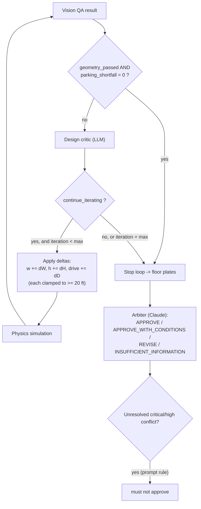

The **loop exit** is a hard rule in code. The critic only proposes *which* geometry to change, and only through three
allowed parameters. The **arbiter** is told it must not approve a design that leaves a critical or high conflict
unresolved, and that `geometry_passed` says nothing about parking.

### 3.6 A real run (2026-10-05, 17:29)

| Step | Agent | Model | Time | Result |
|---|---|---|---|---|
| 1 | vision_input | classical CV | 0.4 s | sketch consistent with site_conditions |
| 2 | intake | gpt-oss-20b | 14.4 s | 120 units, 4 floors |
| 3 | zoning | gpt-oss-20b | 9.5 s | envelope 170 × 265 ft (45,050 SF) |
| 4 | baap_matching | gpt-oss-120b | 20.8 s | 120 unit modules, 111,988 GSF |
| 5 | conflict | gpt-oss-120b | 4.6 s | 1 conflict (parking, high); not feasible as requested |
| 6 | simulation | physics | 0.0 s | 6 steps, penalty 0.438, converged |
| 7 | vision_qa | classical CV | 0.7 s | geometry OK; **stalls 15/150 (shortfall 135)**; coverage 46.3 % |
| 8 | design_critic | gpt-oss-120b | 4.7 s | stop: "shortfall cannot be resolved by geometry tweaks" |
| 9–10 | floor_plate | rule-based | 1.7 s | typical floor 14 units placed (19 deferred); ground 11 (18 deferred) |
| 11 | arbiter | claude-sonnet-5 | 10.4 s | **REVISE (confidence 0.93)** |

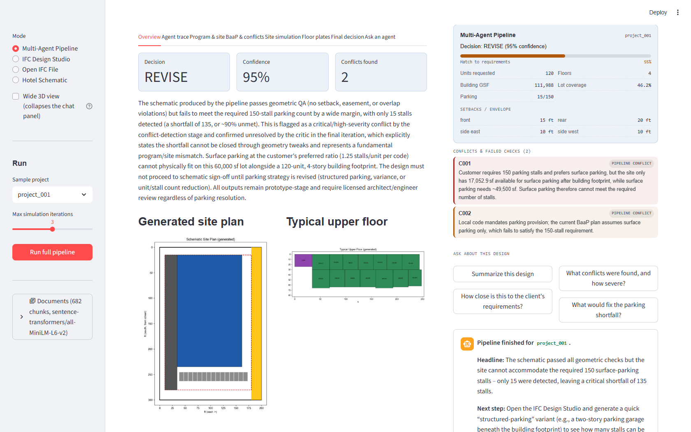
*Figure 1 – Pipeline result in the app (browser run on 2026-10-05): decision, confidence, conflicts, generated site plan
and floor plate, with the assistant's note.*

---

## 4. Knowledge base and retrieval (RAG)

### 4.1 What is in it

| Source | Kind | Chunks | How it is chunked |
|---|---|---|---|
| `zoning_code_sample.md` | synthetic | 9 | by Markdown heading, then ~1,000-character windows |
| `baap_catalog.md` | synthetic | 7 | same |
| `baap_stacking_rules.md` | synthetic | 6 | same |
| `design_guidelines.md` | synthetic | 5 | same |
| `RNGD_IBC_2021_R1_Five_Story_AI_Rules_v0_2.csv` | **real (RNGD)** | 42 | one chunk per rule (id, operator, value, units, description) |
| `rngd_ibc_2021_r1_five_story_ai_ready_v0_2.xlsx` | **real (RNGD)** | 5 | one chunk per sheet (first 3,000 characters) |
| `ada_2010_standards_for_accessible_design.pdf` | **real (DOJ)** | 608 | 1,200-character windows per page, blank pages skipped |
| **Total** | | **682** | 27 synthetic + 655 real |

Every chunk carries `source_kind` ("synthetic" or "real"), so answers can say which kind of source they rest on.

### 4.2 How retrieval works

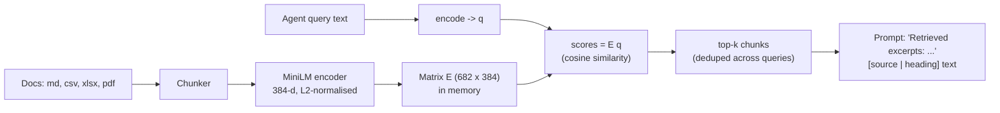

Each chunk $c_i$ and query $q$ are embedded and normalised ($\lVert e \rVert = 1$), so the score is the cosine similarity

$$
s_i = \mathbf{e}_i \cdot \mathbf{e}_q = \cos\theta_i,\qquad \text{retrieve } \operatorname{top}_k\, s_i .
$$

If the embedding model cannot load, the store falls back to TF-IDF with the same interface:
$s_i = \frac{\mathbf{t}_i\cdot \mathbf{t}_q}{\lVert \mathbf{t}_i\rVert\,\lVert \mathbf{t}_q\rVert}$.

**Multi-query retrieval.** One broad query on a multi-topic corpus tends to return only the best-matching section. The
zoning agent therefore sends **six narrow queries** (setbacks; height/FAR/coverage; parking; fire lane; ADA route; exit
travel), takes the top 2 of each and removes duplicates. This fixed a real bug where setbacks were missed.

**Example** (from the experiment). The query "dead-end corridor maximum length sprinklered" returns:

| Rank | Source | Chunk | Score |
|---|---|---|---|
| 1 | RNGD IBC CSV (real) | IBC-R1-027 Dead-end corridor maximum for sprinklered R-1 | 0.689 |
| 2 | zoning_code_sample.md (synthetic) | 4.4 Fire and Life-Safety Access | 0.540 |
| 3 | RNGD IBC CSV (real) | IBC-R1-026 Minimum corridor width when occupant load is under 50 | 0.493 |

**Who uses retrieval:** the zoning, BaaP and conflict agents, `ask_agent`, and the chat assistant (top-3 for each question).
The hotel and IFC code screens do **not** use retrieval; they read RNGD's rule CSV directly as data.

---

## 5. The physics engine

`src/rngd/simulation/physics_engine.py` treats the site as a small 2D rigid-body system.

### 5.1 Bodies

| Body | Size | Movable | Initial position |
|---|---|---|---|
| Building | $w \times h$, with $w = \min(0.75\,W_{env}, 150)$ and $h = A_{fp}/w$ | yes | front of envelope, centred |
| Driveway | $24 \times D_{env}$ ft | no | west edge |
| Parking stalls | $9 \times 18$ ft each | no | rows behind the building, 24 ft aisles |

**How many stalls fit is geometry.** Stalls per row and rows are

$$
k_{row} = \left\lfloor \frac{W_{env} - 24 - 4}{9} \right\rfloor,\qquad
y_0 = y_{min} + h + 10,\qquad
\text{rows} = \#\{\, j : y_0 + 42j + 18 \le y_{max} \,\}
$$

For Elm Street, $k_{row} = \lfloor 142/9 \rfloor = 15$ and $h = 27{,}997/127.5 = 219.6$ ft, so $y_0 = 15 + 219.6 + 10 = 244.6$.
Only $j = 0$ satisfies $244.6 + 18 \le 280$. That gives **one row of 15 stalls**, exactly the "15 of 150" the pipeline and arbiter reported.

### 5.2 Forces

**Containment.** A penalty spring pushes a body back inside the envelope:

$$
F^{c}_x = \max(0, x_{min} - x_0) - \max(0, x_1 - x_{max}),\qquad
F^{c}_y = \max(0, y_{min} - y_0) - \max(0, y_1 - y_{max})
$$

**Separation.** For two overlapping rectangles with overlaps $o_x, o_y > 0$, they are pushed apart along the axis of
*least* overlap (the separating-axis heuristic), half each:

$$
\mathbf{F}^{s}_{a} = -\mathbf{F}^{s}_{b} = \tfrac12 \begin{cases}
(\sigma_x\, o_x,\ 0) & o_x < o_y \\
(0,\ \sigma_y\, o_y) & \text{otherwise}
\end{cases},\qquad \sigma = \begin{cases} -1 & c_a < c_b \\ +1 & \text{otherwise}\end{cases}
$$

with $o_x = \max(0, \min(a_{x1}, b_{x1}) - \max(a_{x0}, b_{x0}))$ (and the same for $y$), and $c$ the body centres.

### 5.3 Integration and convergence

Semi-implicit Euler with damping $d = 0.55$ and gain $g = 0.5$, for movable bodies only:

$$
\mathbf{v}_{t+1} = d\,(\mathbf{v}_t + g\,\mathbf{F}_t),\qquad \mathbf{x}_{t+1} = \mathbf{x}_t + \mathbf{v}_{t+1}
$$

The total penalty $\Pi_t = \sum |F^c| + \sum |F^s|$ (in feet) is recorded every step. The run **converges** when
$\Pi_t < 0.5$ ft, and stops at 250 steps otherwise. Positions are then snapped to a 1 ft grid.

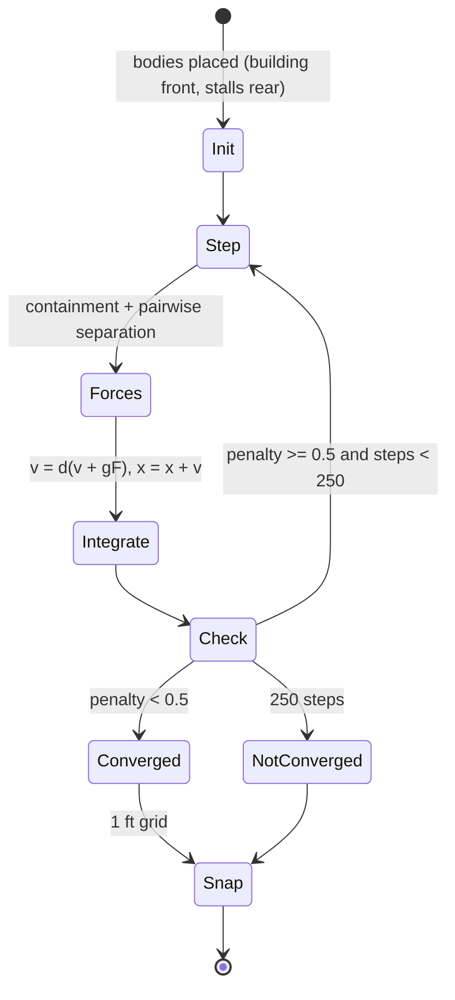

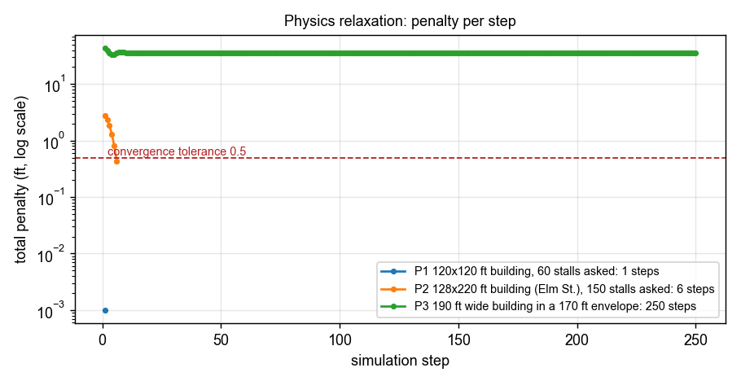
*Figure 2 – Penalty per step in three experiments:*
- *P1: a building that already fits converges in 1 step.*
- *P2: the Elm Street building nudges off the driveway and converges in 6 steps.*
- *P3: a 190 ft-wide building in a 170 ft envelope can never satisfy containment. The penalty flattens at 36 ft and the run stops at 250 steps. This is exactly the case where the critic must say "this is a program/site conflict, not a geometry tweak".*

**What the physics engine does *not* do:** it does not change how many stalls exist; the stall rows are fixed at set-up.
The docstring mentions an "attraction" toward the street and the rear. In the code, that preference comes only from
the initial placement; no attraction force is applied. The floor plates are made by a separate rule-based packer, not
by the physics.

---

## 6. Computer-vision QA and the critic loop

The vision QA agent does **not** trust the simulation's own numbers. It opens the rendered PNG and measures it again:

1. **Calibration.** The renderer writes a sidecar with two reference points in feet and pixels. Then
   $x_{ft} = x^0_{ft} + (x_{px} - x^0_{px})\,s_x$, with $s_x = \frac{x^1_{ft}-x^0_{ft}}{x^1_{px}-x^0_{px}}$ (same for $y$).
   An earlier DPI mismatch caused a 1.4× scale error here, and it was fixed.
2. **Colour masks.** A pixel belongs to a class when $\sum_{c\in\{R,G,B\}} |I_c - \text{ref}_c| \le 30$.
3. **Building.** The mask's bounding box gives the footprint, coverage $= 100\,A_{fp}/A_{lot}$, and setback violations
   (outside the envelope by more than 1 ft).
4. **Easement.** More than 5 overlapping building/easement pixels counts as a violation.
5. **Parking.** Connected components of the parking mask (`scipy.ndimage.label`), keeping components larger than 15 % of
   the largest, so anti-aliasing specks are not counted. Shortfall $= \max(0, S_{req} - S_{det})$.

`geometry_passed` and `parking_shortfall` are deliberately separate, so a design can be geometrically clean and still
fail on parking. The critic and arbiter are both told this.

---

## 7. How the hotel design is created

The hotel mode (RNGD's first use case) uses **no LLM at all** to make the design. It is a deterministic generator:
the same program and settings always give the same building, and a different program gives a different building.

### 7.1 Pipeline of the hotel generator

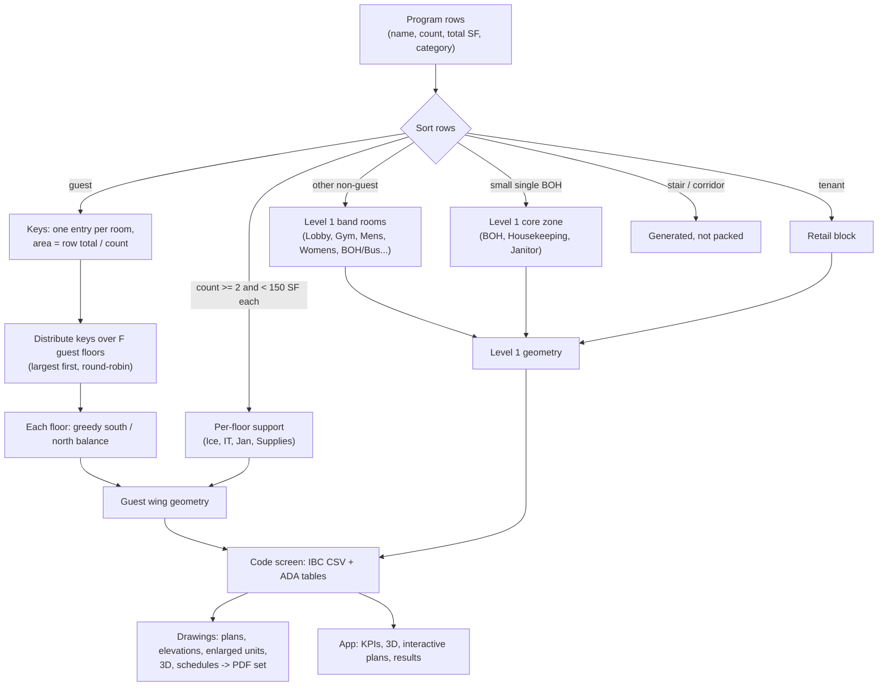

### 7.2 The guest floor

Every guest floor is a double-loaded corridor wing:

```
      x=0      10        34                                                   L-10      L
y=58  +--------+---------+----------------------------------------------------+---------+
      | Linen  | Ice/IT/ |  north rooms  ->  (each room: width = area / 26)   | Stair 2 |
      | /flex  | Jan/Sup |                                                    |         |
y=32  +--------+---------+----------------------------------------------------+---------+
      |                         CORRIDOR (6 ft clear)                                   |
y=26  +--------+---------+----------------------------------------------------+---------+
      | Stair 1| Elev x2 |  south rooms  ->                                             |
      |        | shafts  |                                                              |
y=0   +--------+---------+--------------------------------------------------------------+
            core zone 34 ft
```

**Room size.** With room depth $d = 26$ ft, a room of area $A_i$ is

$$
w_i = \frac{A_i}{26}\ \text{ft}\qquad(\text{King: } 343/26 = 13.2\text{ ft, close to the L+L King room})
$$

**Keys to floors.** Keys sorted by area (largest first) go round-robin, so suites spread across floors:

$$
\text{floor}(k) = k \bmod F,\qquad k = 0,1,\dots,N_{keys}-1
$$

**South / north balance.** The north side starts with a 10 ft offset because Stair 2 sits at its east end. Each room goes to the side with the shorter run:

$$
R_S \leftarrow 0,\quad R_N \leftarrow 10;\qquad \text{for each room } i:\ \ s^* = \arg\min_{s\in\{S,N\}} R_s,\quad R_{s^*} \leftarrow R_{s^*} + w_i
$$

**Wing length, gross area, height.** Every floor uses the longest wing:

$$
L = 34 + \max_{\text{floors}} \max(R_S, R_N),\qquad G_{level} = L \times 58,\qquad H = h_1 + F\,h_t
$$

with $h_1 = 16$ ft (Level 1) and $h_t = 10.75$ ft per guest floor, the heights read from the L+L elevations. Default
program: $L = 217$ ft and $H = 16 + 5(10.75) = 69.75$ ft.

### 7.3 Level 1

1. The core zone is stacked under the guest-floor core, so stairs and elevators line up on every level.
2. The **lobby goes first** on the south (street) band; the other band rooms are sorted by size and each goes to the
   shorter band (the same greedy rule as above).
3. If Stair 2 falls east of the band rooms, the **tenant (retail) block** is full depth at the east end and wraps around
   Stair 2. Its length is $\ell_{ten} = (A_{ten} + A_{stair})/58$, and Level 1 is at least as long as the tower.

Default program: band rooms end at 168.7 ft, retail is 65.4 ft, so Level 1 is 234 ft long (it fits the 265 ft envelope).

### 7.4 Code screen (from RNGD's real rule CSV and the ADA PDF)

| Rule | Formula used | Default result |
|---|---|---|
| IBC-R1-007 stories | $F + 1 \le 5$ (Level 1 is a story above grade) | 6 → **FAIL** |
| IBC-R1-005 height | $H \le 85$ ft | 69.75 → PASS |
| IBC-R1-010 area per story | $\max G_{level} \le 72{,}000$ SF | 13,575 → PASS |
| IBC-R1-012 high-rise screen | top floor elevation $h_1 + (F-1)h_t \le 75$ ft | 59 → PASS |
| IBC-R1-015 exits | 2 stairs, occupant load $\le 500$ per floor | 316 → PASS |
| IBC-R1-018 exit separation | $(L - 10) \ge \tfrac13\sqrt{L^2 + 58^2}$ | 207 ≥ 75 → PASS |
| IBC-R1-023 travel | $T = \tfrac{L - 10}{2} + 26 \le 250$ ft | 129.5 → PASS |
| IBC-R1-025 corridor | $72 \ge 44$ in | PASS |
| IBC-R1-027 dead end | $\max(5,\ L - (L - 5)) = 5 \le 50$ ft | PASS |
| IBC-R1-028 door | 34 in clear $\ge 32$ | PASS |
| ADA 224.2 | Table 224.2: 101–150 rooms → 5 + 2 roll-in = 7 | 7 provided → PASS |
| ADA 224.4 | Table 224.4: 101–150 rooms → 12 | not designated → REVIEW |
| ADA 224.5 | ADA rooms spread over room types | 3 types → PASS |

**Occupant load** uses the CSV's IBC Table 1004.5 factors: residential 200, business 150, storage 300, mercantile 60,
exercise 50, kitchen 200, and lobby assembly 15 SF net:

$$
OL_{level} = \sum_{\text{rooms}} \left\lceil \frac{A_r}{f_r} \right\rceil
$$

**Gross area, three ways.** The source sheets' 74,195 SF, the drawn total, and the meeting rule (33 % circulation, 8 % wall burden, rounded up to 100 SF):

$$
G_{rule} = 100\left\lceil \frac{N_{net}(1 + 0.33)(1 + 0.08)}{100}\right\rceil = 100\left\lceil\frac{59{,}350 \times 1.4364}{100}\right\rceil = 85{,}300\ \text{SF}
$$

### 7.5 From numbers to drawings

1. **Room detailing.** Each room type is described once in *local* coordinates $(u, v)$: $u$ runs along the corridor, $v$ from the corridor ($v = 0$) to the window ($v = 26$). The description includes walls with door openings, door swings, WC, vanity, shower, closet, beds sized by type, a suite partition, a spa tub and ADA 5 ft turning circles.
2. **Placing a room.** Each room in the plan is drawn by a transform. For a south-side room at $(x_r, y_r)$ with width $w$, mirrored on alternate rooms so bathrooms pair up:

$$
(x, y) = \bigl(x_r + (w - u \text{ if mirrored else } u),\ \ y_r + 26 - v\bigr)\qquad(\text{north side: } y = y_r + v)
$$

3. **3D views.** The same primitives are extruded to boxes: walls 9 ft, doors 7 ft, windows from 2.5 to 8 ft. An orthographic projector (camera azimuth $\theta$, elevation $\varphi$) maps a 3D point $\mathbf{p}$ to the screen:

$$
\mathbf{c} = (\cos\varphi\cos\theta,\ \cos\varphi\sin\theta,\ \sin\varphi),\quad
\mathbf{r} = (-\sin\theta, \cos\theta, 0),\quad \mathbf{u} = \mathbf{c}\times\mathbf{r},\quad
(X, Y) = (\mathbf{p}\cdot\mathbf{r},\ \mathbf{p}\cdot\mathbf{u})
$$

   A face is drawn only if its normal faces the camera ($\mathbf{n}\cdot\mathbf{c} > 0$), in order of depth $\mathbf{p}\cdot\mathbf{c}$ (a painter's algorithm), shaded by orientation.

4. **Sheets.** Matplotlib draws the sheets at true scale (1" = 20'-0" for plans, 1/8" = 1'-0" for unit plans) in the RNGD L+L format: column grid of ≤ 32 ft bays (the meeting said 30–34 ft), dimension strings and title block.

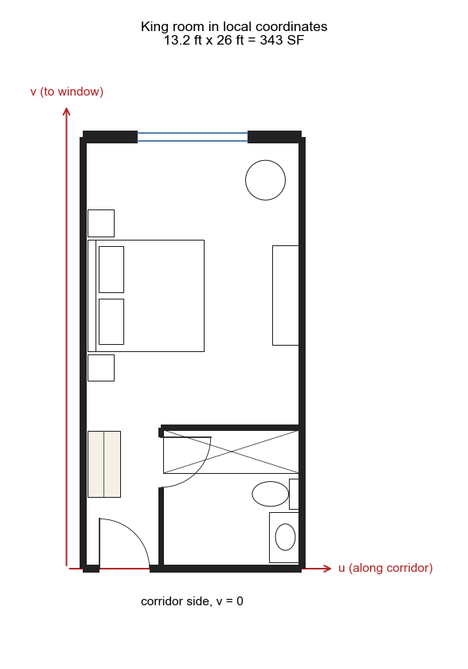
*Figure 3 – A King room described once in local $(u, v)$ coordinates; every King on every floor is this geometry, transformed.*

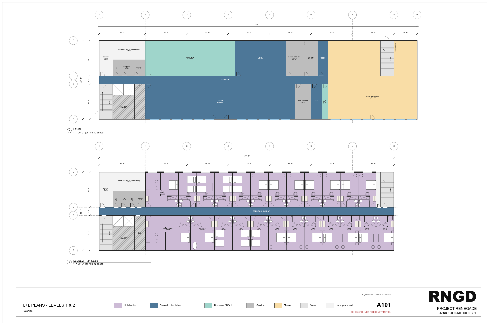
*Figure 4 – Sheet A101 from the generated drawing set: Level 1 and Level 2 plans.*

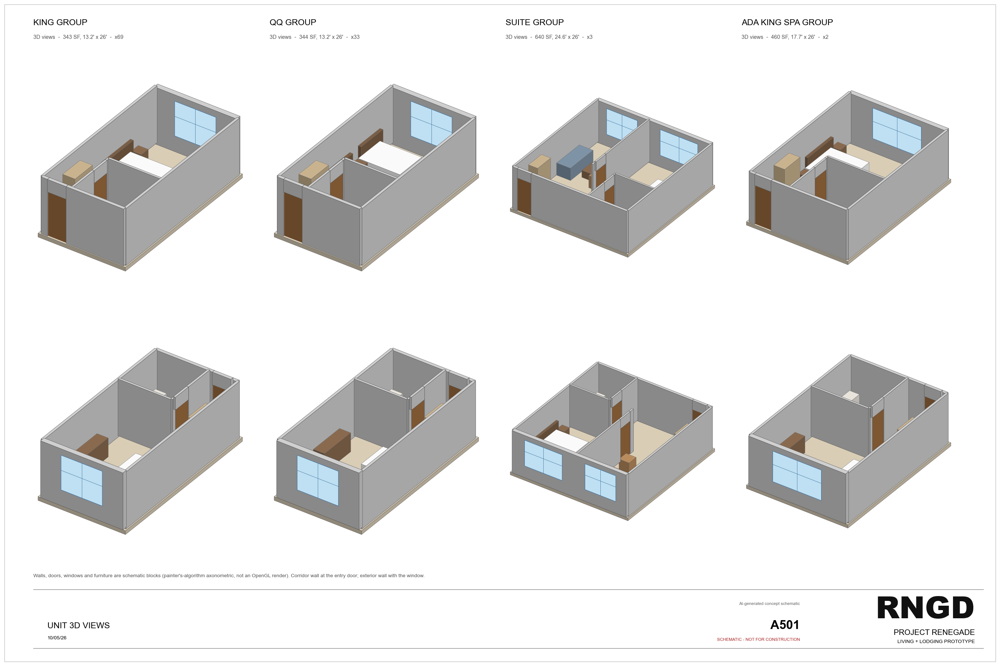
*Figure 5 – Sheet A501: unit 3D views made by the painter's-algorithm projector.*

---

## 8. Is it hallucinating, or is it dynamic? The evidence

### 8.1 The hotel engine responds to its inputs, and repeats exactly

Four inputs, each built twice. The "hash" is a SHA-256 of every room's position and size plus every check result:

| Case | Keys | Levels | Keys per guest floor | Wing (ft) | Level 1 (ft) | Gross drawn (SF) | Height (ft) | ADA required → provided | Checks | Fails | Rerun identical |
|---|---|---|---|---|---|---|---|---|---|---|---|
| A1 L+L program, 5 floors | 117 | 6 | 24, 24, 23, 23, 23 | 217.0 | 234.1 | 76,508 | 69.75 | 7 → 7 | 13 pass | stories | **yes** (`f1ecee4c…`) |
| A2 same program, 4 floors | 117 | 5 | 30, 29, 29, 29 | 258.0 | 258.0 | 74,828 | 59.00 | 7 → 7 | 14 pass | none | **yes** (`7b58316d…`) |
| A3 different 76-key program | 76 | 5 | 19, 19, 19, 19 | 167.5 | 167.5 | 48,564 | 59.00 | 5 → 4 | 13 pass | ADA rooms | **yes** (`ff6fff58…`) |
| A4 program scaled to 161 keys | 161 | 6 | 33, 32, 32, 32, 32 | 288.4 | 288.4 | 100,359 | 69.75 | 8 → 10 | 12 pass | stories, envelope | **yes** (`b4fea144…`) |

What this shows:
- **Different inputs give different, sensible buildings.** Fewer floors give a longer wing; a smaller program gives a shorter wing; a bigger program overflows the 265 ft envelope.
- **The checks react to the input.**
  - A2 passes the story limit because Level 1 plus four floors makes five stories.
  - A3 has only 4 ADA rooms where Table 224.2 needs 5 for 76 rooms, so it fails.
  - A4 is too long for the lot.
- **Identical inputs give identical output**, down to every room, so there is no randomness in the design.

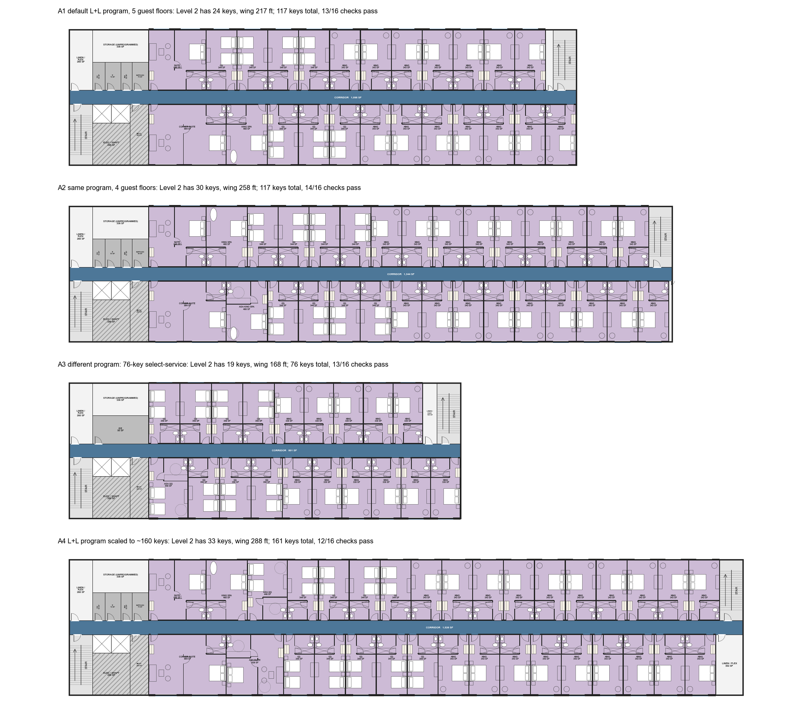
*Figure 6 – Level 2 of the four cases, drawn at the same scale.*

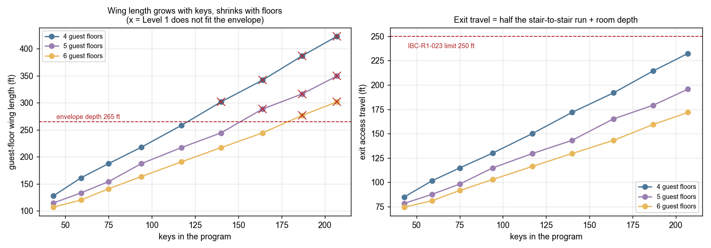
*Figure 7 – Sweep from 43 to 207 keys at 4, 5 and 6 guest floors.*
- *Wing length grows with keys and shrinks with floors; × marks the cases where Level 1 does not fit the 265 ft envelope.*
- *Exit travel follows $T = (L-10)/2 + 26$ and stays under the 250 ft limit across the whole range.*

### 8.2 The LLM agents extract what the documents say

**Intake agent** (`gpt-oss-20b`), given the real request twice and an edited request once. The edit changed units 120→84,
stories 4→6, mix 20/45/35→10/50/40 and budget $28.0 M→$19.5 M:

| Input | Units | Floors | Mix (studio / 1BR / 2BR) | Budget | Hard requirements |
|---|---|---|---|---|---|
| original, run 1 | 120 | 4 | 0.20 / 0.45 / 0.35 | $28,000,000 | "120 units" |
| original, run 2 | 120 | 4 | 0.20 / 0.45 / 0.35 | $28,000,000 | "120 units" |
| **edited** | **84** | **6** | **0.10 / 0.50 / 0.40** | **$19,500,000** | "84 units firm requirement", "parking per local code" |

All structured values follow the text exactly. The free-text list of hard requirements is worded differently, as
expected from a language model.

**Zoning agent**, run twice, compared with the values printed in `zoning_code_sample.md`:

| Limit | Knowledge base | Run 1 | Run 2 |
|---|---|---|---|
| max height | 65 ft | 65 | 65 |
| max stories | 5 | 5 | 5 |
| max FAR | 2.5 | 2.5 | 2.5 |
| max coverage | 60 % | 60 | 60 |
| front / side / rear setback | 15 / 10 / 20 ft | 15 / 10 / 20 | 15 / 10 / 20 |
| parking ratio | 1.25 per unit | 1.25 | 1.25 |
| fire lane width | 20 ft | 20 | 20 |
| **all 9 match** | | **yes** | **yes** |

Each value came with a citation such as "4.2 Bulk and Dimensional Standards: max height".

**Arbiter narrative.** Every number in the saved run's narrative was checked against the computed data:

| Number in the narrative | Where it comes from | Found in computed data |
|---|---|---|
| 1.25 | zoning parking ratio | yes |
| 15 | stalls detected by vision QA | yes |
| 120 | units in the program | yes |
| 135 | parking shortfall (150 − 15) | yes |
| 150 | required stalls (1.25 × 120) | yes |

### 8.3 Three real runs of the same project: what changed, what did not

| | Browser run (15:55) | Test-suite run (16:12) | Later run (17:29) |
|---|---|---|---|
| Decision | REVISE (0.95) | REVISE (0.95) | REVISE (0.93) |
| Conflicts | 2 | 2 (critical + medium) | 1 (high) |
| Critic | stopped; shortfall left unresolved | tried a +50 × 50 ft footprint, then stopped | stopped after iteration 1 |
| Stalls found by CV | 15 / 150 | 34 / 150 (after the critic's change) | 15 / 150 |
| Narrative's numbers | from its own CV data | from its own CV data | from its own CV data |

*The browser run's figures come from its screenshots and the assistant's note; the other two runs come from their saved results.*

**Stable across runs:**
- the extracted program;
- the zoning limits and envelope;
- the module counts;
- the feasibility numbers;
- the decision (**REVISE in 3 of 3**);
- the reason: surface parking cannot fit.

**Varies across runs:**
- how the LLM *rates* and *words* the conflicts;
- whether the critic tries one more geometry change. In the 16:12 run it enlarged the building, which pushed it outside the envelope; the vision QA caught the setback violation, and the arbiter still returned REVISE.

The numbers differ between runs because the geometry differed, not because the model invented them.

### 8.4 Where hallucination can still happen

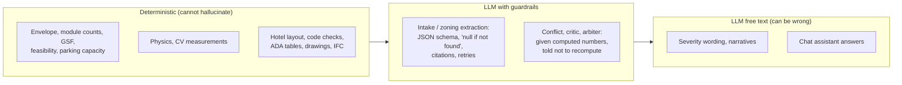

The guardrails in the code:
1. **Arithmetic is never left to the model.** The envelope, counts, areas, FAR/coverage capacity and parking are all computed in Python.
2. **Structured output.** Every agent must return JSON validated by a pydantic schema. Malformed JSON is sent back for a retry (up to 3 attempts).
3. **"Use null; never invent a number"** in the zoning prompt, plus citations to the retrieved section.
4. **Independent measurement.** Vision QA re-measures the drawing instead of trusting the simulation.
5. **Narrow action space.** The critic can only change three parameters; the loop stops at a fixed maximum in code.
6. **Conservative arbiter rule.** It must not approve with an unresolved critical or high conflict.
7. **No LLM in the hotel design.** The hotel and IFC designs are pure code.
8. **Timeouts.** LLM requests time out after 90 s, so one stalled request no longer freezes a run.

**An observed error, for honesty.** In the walkthrough run, the chat assistant explained the story-count failure using
"height ≥ 8 ft" as the IBC story definition. That is not in RNGD's rules. The code screen's result was correct; the
explanation around it was not. **Treat chat answers as explanations, and the code screens as the facts.**

---

## 9. Limitations and what to improve

| Area | Limitation now | Suggested next step |
|---|---|---|
| Pipeline inputs | Request, site, zoning and BaaP catalog are synthetic | Load a real RNGD project and lot |
| Physics | Stalls are fixed at set-up, so the simulation cannot add parking; no attraction force | Make the parking field a body; add structured parking as an option |
| Floor plates | One wing only; many units deferred (14 placed, 19 deferred on the typical floor) | Multi-wing packing (L/U shapes) |
| Hotel layout | Single straight double-loaded wing; no parking, structure or MEP | L-shaped plans like the L+L set; parking; column-grid-aware room widths |
| Hotel code screen | 11 of 42 IBC rules evaluated; communication-feature rooms not designated | Space-level occupancy modelling; mark ADA 224.4 rooms in the program |
| LLM variation | Conflict counts and critic choices vary between runs | Fix temperature at 0 for judgments; run 3× and take a majority; log disagreements |
| Chat | Can state code facts not in RNGD's documents | Force citations to retrieved chunks; refuse uncited code claims |

---

## 10. How to reproduce everything here

```bash
python src/how_it_works_experiments.py           # hotel cases, sweep, physics, LLM extraction tests (makes ~5 LLM calls)
python src/how_it_works_experiments.py --no-llm  # only the deterministic experiments
python src/run_pipeline.py                       # one full pipeline run -> outputs/project_001/project_state.json
streamlit run src/app.py                         # the app (all four modes)
python -m pytest tests                           # 35 tests
```

| File | What it is |
|---|---|
| `src/rngd/orchestrator.py` | pipeline order, simulation loop, floor plates |
| `src/rngd/agents/*.py` | the six LLM agents (prompts, computed inputs, schemas) |
| `src/rngd/vectorstore.py`, `src/rngd/real_docs.py` | knowledge base and retrieval |
| `src/rngd/simulation/physics_engine.py` | the physics engine |
| `src/rngd/vision/layout_qa.py` | computer-vision QA |
| `src/rngd/hotel/layout.py`, `code_check.py`, `details.py` | hotel generator, code screen, ADA and program details |
| `src/rngd/hotel/drawings.py` | drawing sheets and the 3D projector |
| `reports/how_it_works/experiments.json` | raw results behind Sections 3.6 and 8 |
